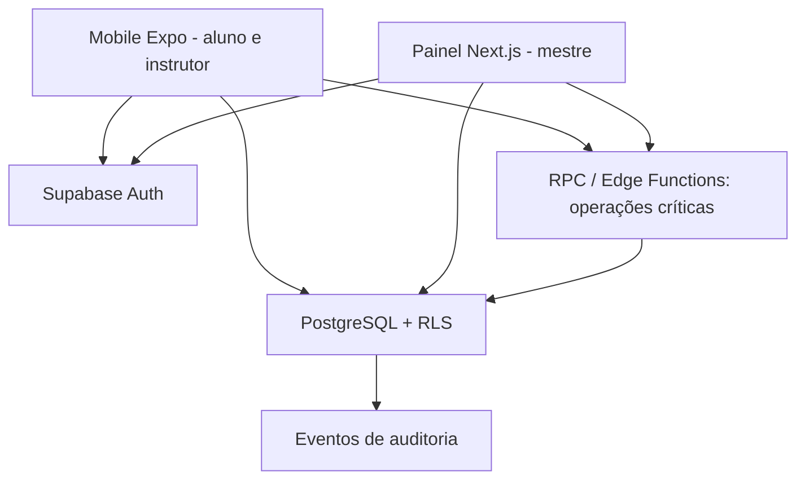

# Arquitetura v1.0

## Visão

## Princípios
Monólito lógico gerenciado (Supabase) com módulos: identidade, academia/filiação, catálogo, diário, aulas, presença, currículo e graduação. Compartilhar schemas Zod e funções puras via `packages/`.

## Multi-tenancy
- `users/profiles`: identidade global.
- `academies`: tenant operacional e contratante.
- `memberships`: vínculo com academia, papel e status.
- Tabelas operacionais contêm `academy_id`, constraints e RLS; tabelas globais de técnicas podem ter `academy_id NULL` com leitura pública autorizada.
- **Nunca** confiar apenas em filtro frontend; banco é a fronteira de segurança.
- Afiliação a equipe (`teams`) e unidades são evoluções previstas; não misturar com tenant no MVP.

## Operações críticas
`request_membership`, `decide_membership`, `validate_attendance`, `grant_promotion` devem ser implementadas como RPC/Edge Function com autenticação, verificação do papel, transação, idempotência e auditoria. Nenhuma dessas ações deve ser feita com UPDATE direto liberado para clientes.

## Fotos (Storage)
**Estado atual (ADR-022, 2026-10-20):** o Supabase Storage **não é usado**. A foto do feed é processada no servidor do painel (remove EXIF e localização, gira, reduz a 1600 px, regrava como JPEG; limites de 8 MB de entrada e 800 KB depois do processamento) e guardada numa coluna `bytea` de `feed_posts`, entregue por uma rota do painel sob a mesma regra de acesso (RLS) do banco. Retenção de 30 dias com apagamento real (`pg_cron`). Foto de menor só com consentimento verificado do responsável.

**Quando migrar para Storage privado com CDN:** vídeo, logotipo/capa de academia, foto de perfil ou volume que faça a tabela e o backup crescerem demais. Aí valem as diretrizes originais: buckets privados; caminho com UUID, e.g. `academy_id/user_id/uuid.webp`; URLs assinadas de curta duração e autorização na emissão; remover EXIF; limites de upload; conteúdo de menor bloqueado por padrão.

## Ambientes
Local (Supabase CLI) → homologação → produção, projetos e segredos separados. Migrações versionadas, seed sintética e CI. Nunca utilizar dados reais no desenvolvimento.

## ADRs
ADR-001 Supabase/Postgres no MVP, NestJS apenas se justificativa operacional futura.
ADR-002 TypeScript no mobile, web e domínio.
ADR-003 Multi-tenant desde a primeira migration.
ADR-004 Conteúdo técnico versionável e independente de currículo.
