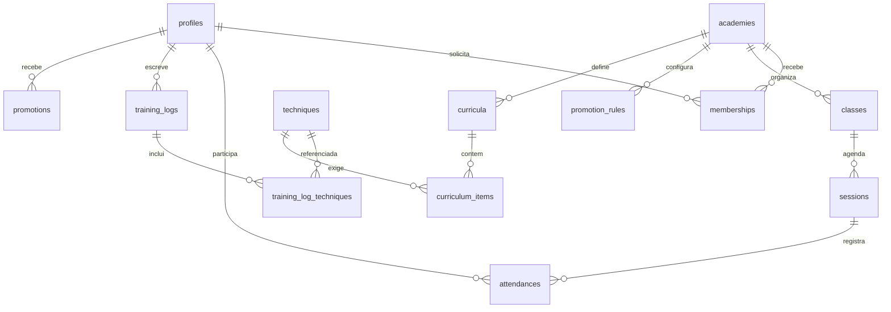

# Modelo de dados lógico

## Entidades MVP
- `profiles(id, display_name, birth_date, avatar_path)`: usuário global vinculado ao auth.
- `academies(id, name, slug, logo_path, theme_primary, theme_secondary, owner_user_id)`: tenant.
- `memberships(id, academy_id, user_id, role, status, reviewed_by, reviewed_at)`: filiação e papéis.
- `techniques(id, academy_id?, name, description, category, level, created_by)`: catálogo global ou local.
- `technique_aliases(technique_id, alias)`: busca e normalização.
- `classes(id, academy_id, title, instructor_user_id)`, `sessions(id, academy_id, class_id, starts_at, ends_at)`.
- `attendances(id, academy_id, session_id, user_id, status, validated_by, validated_at)`: presença.
- `training_logs(id, academy_id?, user_id, session_id?, notes, visibility)`: diário privado; pode registrar treino fora da academia.
- `training_log_techniques(log_id, technique_id)`: N:N, nunca array sem FK.
- `promotion_rules(id, academy_id, belt_code, degree, required_attendances, min_days, effective_from, effective_to)`: regras versionadas.
- `promotions(id, academy_id, user_id, belt_code, degree, granted_by, granted_at)`: eventos de graduação.
- `curricula(id, academy_id, title, level)` e `curriculum_items(id, curriculum_id, technique_id, required)`.
- `skill_assessments(id, academy_id, user_id, technique_id, status, assessed_by, assessed_at)`: domínio técnico validado.
- `audit_events`: alterações críticas, ator, ação, entidade e momento.

## Integridade
Unicidade por academia para filiação; presença única por sessão/aluno; chaves compostas impedem associar sessão de uma academia a presença de outra. Tabelas globais não devem ganhar academy_id fictício. Graduações não são deletadas para zerar contador; corrigir com evento de retificação.

## Evoluções
`teams`, `branches`, `guardians`, `media`, `posts`, `competitions`, `billing_accounts`, `invoices`, `payments` e `consents` com desenho detalhado antes de cada implementação.

## Migração incluída
`supabase/migrations/202610200001_initial.sql` cria **núcleo seguro mínimo**, não todas as tabelas listadas neste modelo. Cada fatia vertical deverá ampliar o esquema e seus testes de RLS.
